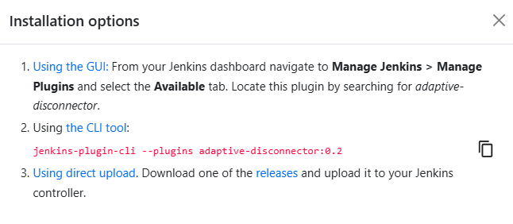

# Adaptive Disconnector Plugin 

## Table of Contents

- [Overview](#overview)
- [How It Works](#how-it-works)
- [Installation](#installation)
- [Configuration](#configuration)

## Overview

Adaptive Disconnector is a Jenkins plugin designed to help identify potentially unhealthy build agents after a failed build.

Whenever a build fails, the plugin reruns all configured node monitors on the affected agent to check whether any monitored metrics have exceeded their defined thresholds. If a threshold is exceeded, the agent can be disconnected before subsequent jobs are scheduled.

By performing this additional health check at build-failure time, Adaptive Disconnector helps Jenkins react to infrastructure issues and avoid assigning new workloads to agents that may be experiencing problems.

## How It Works

Adaptive Disconnector follows a simple workflow:

1. A build running on a Jenkins agent fails.
2. The plugin triggers the execution of all configured node monitors on that agent.
3. Jenkins evaluates the monitored metrics against their configured thresholds.
4. If a monitored threshold is exceeded, the agent can be disconnected.
5. Jenkins can then avoid scheduling subsequent jobs on that disconnected agent.

This mechanism provides an additional opportunity to detect infrastructure problems immediately after a build failure.

## Installation

Adaptive Disconnector can be installed through the Jenkins Plugin Manager.

1. Open **Manage Jenkins**.
2. Navigate to **Plugins**.
3. Open the **Available plugins** tab.
4. Search for `Adaptive Disconnector`.
5. Select the plugin and click **Install**.

You can also find the plugin on the Jenkins Plugin Index:

[Adaptive Disconnector – Jenkins Plugin Index](https://plugins.jenkins.io/adaptive-disconnector/)

## Configuration

Adaptive Disconnector relies on Jenkins node monitors to evaluate the health of build agents.

The plugin does not introduce a separate set of monitoring thresholds. Instead, it reruns the node monitors already configured in Jenkins when a build fails on an agent.

To use the plugin effectively:

- Configure the appropriate node monitors for your Jenkins environment.
- Define suitable thresholds for the metrics you want Jenkins to monitor.
- Ensure that the monitors are enabled and applicable to the agents you want to evaluate.

When a build fails, the plugin triggers these monitors again, allowing Jenkins to identify agents whose monitored metrics exceed the configured thresholds.